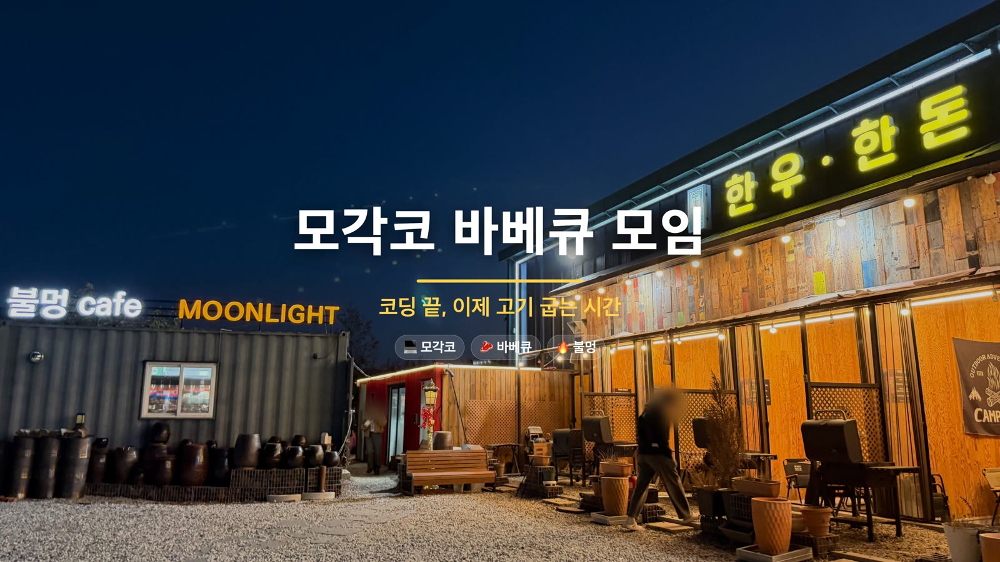
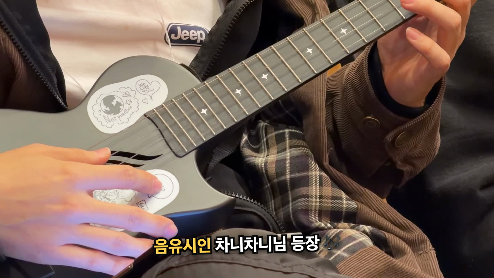
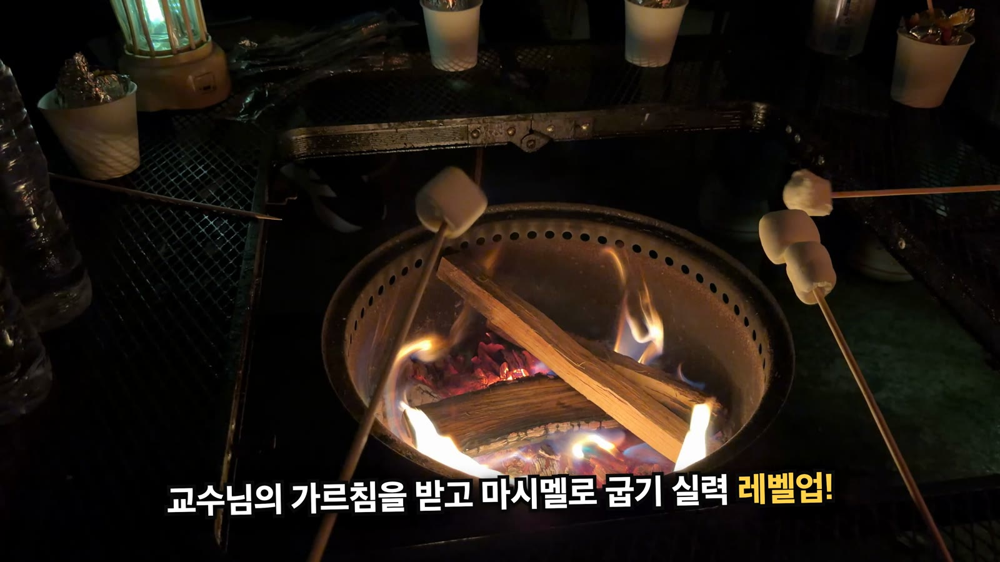

10월 31일 모각코 모임이 끝나고 다 같이 바베큐를 먹으러 갔습니다. 그날 찍은 영상과 사진 59개로 2분 16초짜리 후기 영상을 만들었습니다. 조건은 하나였습니다. **같이 간 사람들 얼굴이 나오면 안 됩니다.**

<div style="position:relative;padding-bottom:56.25%;height:0;overflow:hidden;max-width:720px;border-radius:8px;margin:1.2rem 0;">
  <iframe src="https://www.youtube.com/embed/2gO0yJ3ljV4"
    title="모각코 바베큐 모임 🔥 고기 굽고, 우쿨렐레 듣고, 불멍하며 마시멜로까지"
    loading="lazy" allowfullscreen
    style="position:absolute;top:0;left:0;width:100%;height:100%;border:0;"
    allow="accelerometer; autoplay; clipboard-write; encrypted-media; gyroscope; picture-in-picture"></iframe>
</div>

*완성본. 37컷, 2분 16초, 4K 30fps. 모임 이야기는 [생활노트 후기](https://life.junho85.pe.kr/2026/11/01/mogakco-bbq-meetup.html)에 따로 썼습니다.*

편집은 Claude Code에 맡겼습니다. 제가 만든 편집 파이프라인(avedit)은 컷 목록을 `edl.json`이라는 텍스트로 만들고 Remotion으로 렌더합니다. 저는 결과를 보고 「쫀득이가 더 잘 보이는 장면으로 바꿔 주세요」처럼 말로 고쳤습니다.

얼굴 검출기를 돌려서 사람이 나오는 컷을 걸러 냈는데, **검출기를 통과한 완성본에 얼굴이 여섯 군데 남아 있었습니다.** 전부 완성본을 눈으로 훑어서 찾았고, 그중 하나는 네 번의 렌더 검사를 통과했습니다. 놓친 얼굴은 대부분 화면 위 끝에 턱이나 입만 걸린 모양이었습니다.

## 이것만 기억하면 됩니다 {#tldr}

1. **얼굴을 가리지 말고 얼굴이 없는 구간을 고른다.** 사람이 들어오는 클립은 얼굴이 없는 몇 초만 잘라 쓰고, 위 끝에 걸리면 화면 위쪽을 잘라 낸다
2. **얼굴 검출은 후보를 좁히는 데만 쓴다.** 불꽃, 마시멜로, 펩시 로고는 얼굴로 잡고, 화면 위 끝에 반만 걸린 얼굴은 놓친다
3. **완성본을 0.5초 간격으로 전부 훑고, 위 끝 띠는 따로 크게 본다.** 작은 시트에서는 턱이 흰 셔츠처럼 보였다
4. **BGM 정보는 측정한 것과 AI가 들은 것을 나눠 적는다.** Gemini 두 모델이 같은 곡의 장르와 보컬 유무부터 다르게 들었다
5. **수정하는 동안은 1080p로 렌더하고 4K는 마지막에 한 번만** 한다

## 준비물 {#parts}

| 준비물 | 내용 |
| --- | --- |
| 소재 | iPhone 17 Pro Max로 찍은 영상과 사진, 메신저로 받은 사진. 59개 1.8GB |
| 편집 | avedit. Python으로 EDL(컷 목록)을 만들고 Remotion으로 렌더한다 |
| 사람과 얼굴 검출 | YOLOX-s(사람), YuNet(얼굴). 둘 다 OpenCV DNN으로 돌렸다 |
| BGM | Pixabay 무료 음원 9곡 중 [Heavy Funk Groove](https://pixabay.com/music/funk-heavy-funk-groove-586249/)(ElectroAnimals) |
| 음악 측정 | librosa, ffmpeg `volumedetect` |
| 음악 청취 | Gemini `gemini-3.8-flash`, `gemini-3.7-flash` |
| 작업 | Claude Code. 소재 정리, 컷 선정, 검사, 렌더를 맡겼다 |

## 1단계. BGM 고르기 - 측정한 것과 AI가 들은 것을 나눴다 {#bgm}

Pixabay에서 받은 무료 음원 9곡을 저장소의 `bgm/` 폴더에 모으고, 곡마다 출처와 성격을 문서로 남겼습니다. 정보의 근거가 세 가지라 섞지 않고 적었습니다.

| 근거 | 무엇 | 믿어도 되는 정도 |
| --- | --- | --- |
| 측정 | 길이, 음량, 템포, 조용한 구간(librosa, ffmpeg) | 사실. 단 BPM은 2배나 절반으로 잡힐 수 있다 |
| Pixabay | 곡 페이지의 장르, 무드, 태그, Content ID 표시 | 업로더가 붙인 꼬리표 |
| AI 청취 | Gemini 두 모델이 곡을 듣고 쓴 설명 | **두 모델이 일치한 것만** 적었다 |

AI 청취를 나눈 이유는 두 모델이 생각보다 많이 갈렸기 때문입니다. 한 곡은 한 모델이 삼바, 다른 모델이 만화풍 행진곡으로 들었고 Pixabay 표기는 레게였습니다. 보컬 유무도 곡마다 엇갈렸습니다. 그래서 일치하지 않은 항목은 ❓로 남기고 「직접 들어 보고 확정할 것」 목록으로 따로 모았습니다.

**Content ID**도 같이 확인했습니다. Pixabay 음원도 곡 페이지에 Content ID 등록 표시가 있는 곡은 유튜브에 올리면 저작권 클레임이 걸립니다. 9곡 중 2곡이 등록곡이었습니다. 라이선스 위반은 아니지만 클레임 없이 올리려면 피해야 합니다.

고른 곡은 Heavy Funk Groove입니다. 업로더 태그에 Barbecue, Grill, Fire가 붙어 있을 만큼 바베큐 영상에 딱 맞았고, 4비트가 뚜렷해서 컷을 박자에 맞추기 좋았습니다. 템포는 librosa 기본 추정이 112.3 BPM으로 나왔는데, 박 추적 결과를 직선으로 피팅하니 **110.0 BPM**(잔차 최대 18ms)이었습니다. 컷을 박자에 맞추려면 이 정도 차이도 중요합니다. 2분이면 5박 가까이 어긋납니다.

## 2단계. 소재를 시간순으로 놓기 {#footage}

소재마다 촬영 시각의 근거가 달랐습니다.

| 소재 | 시각 근거 |
| --- | --- |
| 아이폰 영상(MOV) | `CreateDate`. **UTC**라서 코드로 9시간을 더했다 |
| 아이폰 사진(HEIC) | `DateTimeOriginal`. +09:00이 붙어 있다 |
| 메신저로 받은 사진 | 시각 정보가 없다. 사진 내용을 보고 놓았다 |

파일 번호가 `IMG_9999` 다음에 `IMG_0001`로 넘어가서 이름순 정렬도 믿을 수 없었습니다. 라이브포토(HEIC와 MOV 한 쌍)는 영상 쪽이 흔들려서 사진만 썼습니다.

원본 소리는 전부 껐습니다. 대화가 섞여 있었기 때문입니다. 쓸 구간만 발췌하면서 `-an -map_metadata -1`을 붙여 소리와 메타데이터를 같이 지웠습니다. 아이폰 원본에는 촬영 위치(GPS)가 들어 있습니다.

## 3단계. 얼굴이 안 나오게 고르기 {#faces}

### 검출기로 후보를 좁힌다 {#detect}

전체 소재에 YOLOX-s(사람)와 YuNet(얼굴)을 돌려 「큰 사람이나 얼굴이 없는 구간」을 후보로 뽑았습니다. 하지만 이 결과를 그대로 믿을 수는 없었습니다.

- **오탐이 많다.** 불꽃, 노릇하게 구운 마시멜로, 펩시 캔의 로고를 얼굴로 잡았습니다
- **옆얼굴을 놓친다.** 얼굴 검출기는 정면에 가까운 얼굴에 맞춰져 있습니다
- **화면 끝에 잘린 얼굴을 놓친다.** 이게 가장 문제였습니다(아래)

그래서 검출은 후보를 좁히는 데만 쓰고, 실제로 쓸 구간은 원본에서 0.5초 간격으로 프레임을 뽑아 눈으로 봤습니다. 사람이 들어오는 클립은 얼굴이 없는 몇 초만 잘라 썼습니다. 예를 들어 고기를 굽는 한 클립은 앞뒤로 머리가 걸려서 1.6초부터 4.9초까지만 썼습니다.

### 완성본에 얼굴 여섯 군데가 남았다 {#missed}

첫 렌더를 0.5초 간격으로 훑어보니 얼굴이 다섯 군데 남아 있었습니다.

- 가게 외관 사진에서 건물 앞에 선 사람. 옆 사람은 미리 지웠는데 이 사람은 놓쳤다
- 쟁반을 들고 나가는 장면의 화면 위 끝에 걸린 입
- 우쿨렐레 연주 장면 두 컷의 위 끝에 걸린 입과 코
- 소시지 장면의 위 끝에 걸린 턱

전부 **화면 가장자리에 얼굴이 반쯤 잘려 걸린** 모양이었습니다. 얼굴 검출기는 눈, 코, 입이 다 있는 얼굴을 찾도록 학습되어 있어서, 눈이 화면 밖에 있고 턱만 남으면 얼굴로 보지 않습니다.

고친 방법은 세 가지였습니다.

1. **그 컷을 뺀다.** 쟁반 장면과 우쿨렐레 두 컷은 뺐습니다
2. **화면 위쪽을 잘라 낸다.** 소시지 장면은 위 15%를 잘라 냈습니다. 16:9 비율이 유지되도록 좌우도 7.5%씩 같이 잘라 내고 4K로 다시 키웠습니다
3. **사진은 흐리게 지운다.** 외관 사진은 첫 장면에 쓸 만한 다른 사진이 없어서 두 사람의 머리를 흐리게 지웠습니다

사진을 흐리게 지울 때 처음에는 사각형으로 지웠는데, 밤 풍경 위에 네모난 얼룩이 떠서 오히려 눈에 띄었습니다. **타원 모양에 가장자리를 부드럽게 섞는** 방식으로 바꾸니 자연스러워졌습니다.

{: w="1600" h="900" }
_첫 장면. 건물 앞에 선 두 사람의 머리를 타원으로 흐리게 지웠다_

### 다섯 번째 렌더에서 하나 더 {#fifth}

그 뒤로 자막을 고치며 네 번 더 렌더했고, 그때마다 0.5초 간격 시트를 다시 훑었습니다. 그런데 다섯 번째 렌더에서 **남겨 둔 우쿨렐레 장면의 위 끝에 또 입과 턱이 걸려 있는** 것을 찾았습니다. 앞의 네 번은 전부 통과한 장면이었습니다.

원인은 시트 크기였습니다. 4K 프레임을 960px 폭으로 줄인 시트에서는 위 끝에 걸린 턱이 흰 셔츠처럼 보였습니다. 그래서 이 장면도 위 25%를 잘라 내고, 검사 방법도 바꿨습니다.

{: w="1600" h="900" }
_위 25%를 잘라 낸 우쿨렐레 장면. 원본은 화면 위 끝에 연주자의 입과 턱이 계속 걸려 있었다_

- 완성본 전체를 0.5초 간격으로 훑는다 (전과 같다)
- **화면 위 25% 띠만 1초마다 1280px 폭으로 따로 뽑아서 본다** (새로 추가)

이번에 놓친 얼굴 여섯 군데 중 다섯 군데가 화면 위 끝이었습니다. 음식을 내려다보며 찍으면 맞은편 사람이 화면 위 끝에 걸리기 쉬운 것으로 보입니다.

## 4단계. 컷을 박자에 맞추기 {#beat}

컷 경계는 BGM의 마디에 맞췄습니다. 110 BPM에서 한 박은 0.5455초인데, 30fps로 바꾸면 **16.36프레임**이라 프레임 경계와 맞지 않습니다. 컷 시작과 길이를 각각 반올림하면 군데군데 1프레임씩 빈 화면이 생깁니다. 그래서 마디의 시작 시각을 먼저 프레임 번호로 바꾸고, 컷 길이는 프레임 번호의 차이로 정했습니다.

```python
FPS = 30
BEAT = 0.5454738          # 110.0 BPM
BAR = 4 * BEAT
D0 = 0.0609               # 첫 다운비트(초)

def bar_f(k):
    """마디 k의 시작 프레임(정수)."""
    return round((D0 + BAR * k) * FPS)
```

빌드가 끝나면 모든 컷이 앞 컷이 끝난 프레임에서 시작하는지 검사하고, 어긋나면 빌드를 멈춥니다. 조용한 도입부 0~5마디에는 사진과 제목을, 곡이 잠깐 가라앉는 46~50마디에는 마시멜로를 천천히 굽는 장면을 놓았습니다.

## 5단계. 자막은 들은 사실만 쓴다 {#captions}

나레이션 없이 예능 스타일 자막과 음악만 썼습니다. 처음 자막은 화면만 보고 짐작한 부분이 많았고, 이름을 모르는 것은 비워 두었습니다. 사용자(저)가 하나씩 바로잡고 채웠습니다.

| 처음 자막 | 문제 | 고친 자막 |
| --- | --- | --- |
| (이름을 몰라 간식 이름을 쓰지 않았다) | 화면만으로는 무엇인지 알 수 없었다 | 추억의 쫀득이 |
| 마시멜로 교수님 등판 | 화면은 촬영자 시점이라 촬영자가 교수님처럼 읽힌다. 교수님은 촬영자 왼쪽에 앉아 있었다 | 교수님의 가르침을 받고 마시멜로 굽기 실력 레벨업! |
| 옆집이 불멍 카페 | 두 곳은 한 가게였다 | 1차 끝! 2차는 불멍 카페로 |
| 조명 켜고 분위기 ON | 테이블 위 물건은 스피커였다 | 조명 켜고 뮤직 ON |
| 고기 담당 우니님 | 사용자가 원한 표현이 따로 있었다 | 바베큐 전문가 우니님 |

{: w="1600" h="900" }
_고친 자막. 「등판」은 화면 속 손의 주인이 교수님이라는 뜻으로 읽혔다_

장면 순서도 고쳤습니다. 「불멍 cafe MOONLIGHT」 간판 영상은 1차 바베큐 중간에 찍혔는데, 시간순으로 놓으니 2차를 시작하기도 전에 「2차는 불멍 카페」 자막이 나왔습니다. 이 간판을 1차와 2차 사이로 옮겨 장면이 바뀌는 신호로 썼습니다. 고기 종류처럼 화면만으로 확인할 수 없는 것은 자막에 쓰지 않았습니다.

## 6단계. 렌더는 1080p로 고치고 4K는 한 번만 {#render}

이번에는 처음부터 4K로 렌더했습니다. 4K 렌더는 영상 발췌와 별도로 한 번에 약 5분 30초가 걸리는데, 자막을 고칠 때마다 렌더하다 보니 4K를 **8번** 돌렸습니다. 고치는 동안에는 1080p로 확인하고 마무리할 때만 4K로 한 번 렌더하는 것이 맞습니다. 다음 작업부터는 그렇게 하기로 했습니다.

4K는 Remotion 컴포지션을 1920×1080으로 둔 채 `--scale=2`로 렌더합니다. 자막과 카드가 CSS 픽셀 기준이라 1080p 판과 배치가 똑같고, 영상 소재만 3840×2160으로 준비하면 됩니다. 최종본은 790MB였습니다.

렌더가 끝날 때마다 아래를 검사했습니다.

- 어두운 프레임 전수 검사. 마지막 페이드아웃 10프레임 말고는 없어야 한다
- 같은 화면이 이어지는 정지 구간 검사
- 음량. 평균 −16.1dB, 최대 −4.9dB
- 0.5초 간격 시트와 위 25% 띠 (3단계)

## 잘 안 될 때 {#troubleshooting}

### 검출기를 통과했는데 얼굴이 보인다 {#face-miss}

화면 가장자리, 특히 위 끝을 보세요. 반쯤 잘린 얼굴은 검출기가 놓칩니다. 위 끝 띠를 따로 크게 뽑아서 보고, 걸리면 그 컷을 빼거나 위쪽을 잘라 냅니다.

### 사각형 블러가 오히려 눈에 띈다 {#blur}

타원 마스크를 만들고 가장자리를 흐리게 해서 흐린 이미지와 섞으세요. 어두운 배경에서는 사각형의 모서리가 금방 드러납니다.

### 컷 끝에서 화면이 멈춘다 {#freeze}

발췌본(프록시)의 길이가 컷보다 짧을 때 생겼습니다. 프록시 파일 이름에 시작 시각만 넣어서, 컷 길이를 늘려도 예전에 만든 짧은 파일을 그대로 다시 썼습니다. 지금은 빌드할 때 `ffprobe`로 기존 프록시의 길이를 다시 측정하고, 짧으면 새로 만듭니다.

### 첫 컷 앞에 검은 프레임이 생긴다 {#first-frame}

첫 다운비트가 0.061초라서 첫 마디의 시작 프레임이 0이 아니라 2가 됩니다. 첫 컷은 다운비트와 상관없이 0프레임에서 시작하게 했습니다.

### 컷마다 1프레임씩 검은 화면이 생긴다 {#black-frame}

박 길이가 프레임의 정수배가 아니면 생깁니다. 컷 경계를 프레임 번호로 먼저 바꾸고 길이는 그 차이로 정하세요(4단계).

### AI가 들은 곡 설명이 서로 다르다 {#ai-listen}

모델을 바꿔 두 번 듣게 하고, 일치한 것만 믿으세요. 장르와 보컬 유무는 결국 직접 들어 봐야 합니다. 구간 시각도 측정값과 몇 초에서 십수 초씩 어긋나서, 구성은 librosa로 RMS를 측정해 잡았습니다.

## 참고 자료 {#references}

- [모각코 바베큐 모임 후기 (생활노트)](https://life.junho85.pe.kr/2026/11/01/mogakco-bbq-meetup.html)
- [Heavy Funk Groove - ElectroAnimals (Pixabay)](https://pixabay.com/music/funk-heavy-funk-groove-586249/)
- [Pixabay Content License](https://pixabay.com/service/license-summary/)
- [YuNet 얼굴 검출 모델 (OpenCV Zoo)](https://github.com/opencv/opencv_zoo/tree/main/models/face_detection_yunet)
- [YOLOX](https://github.com/Megvii-BaseDetection/YOLOX)
- [Remotion](https://www.remotion.dev/)
- [국민체조 따라하기 영상 직접 만들기](/2026/10/27/gukmin-chejo-3x-video-making.html) - 같은 방식으로 Claude Code에 영상을 맡긴 이전 글
