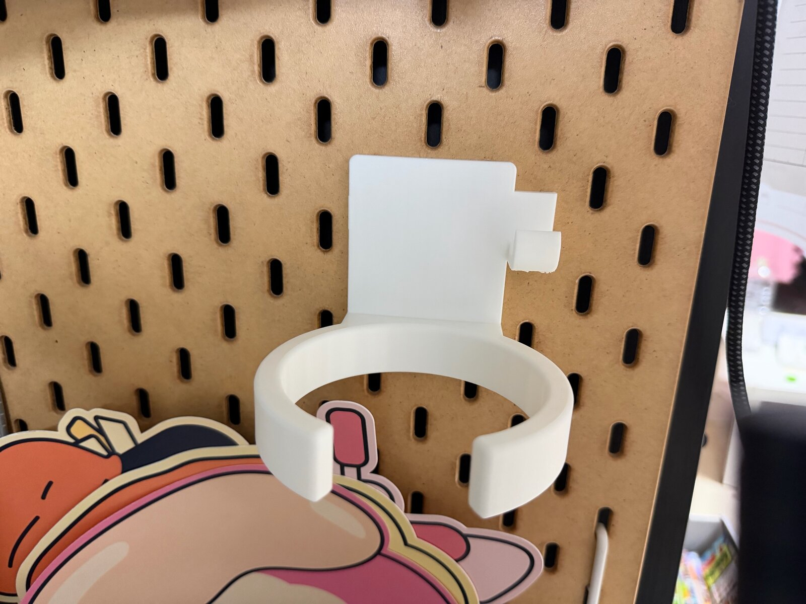
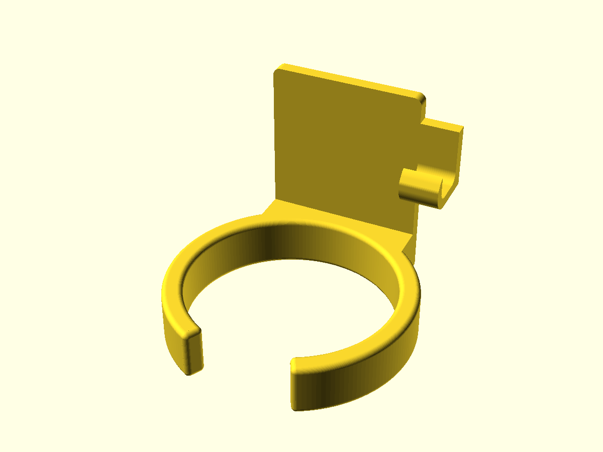
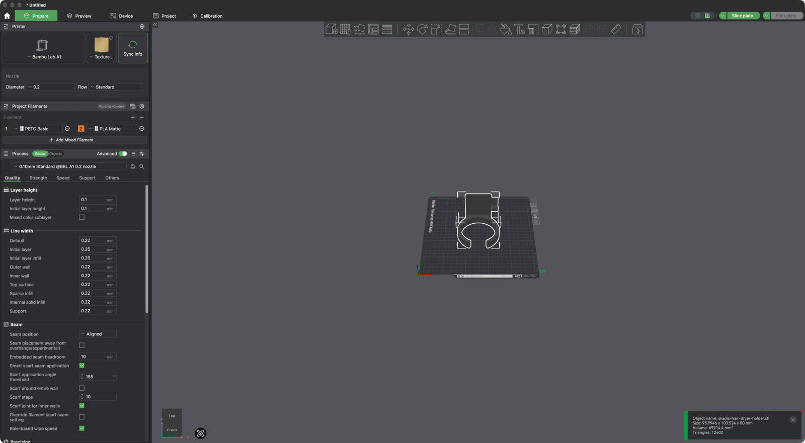
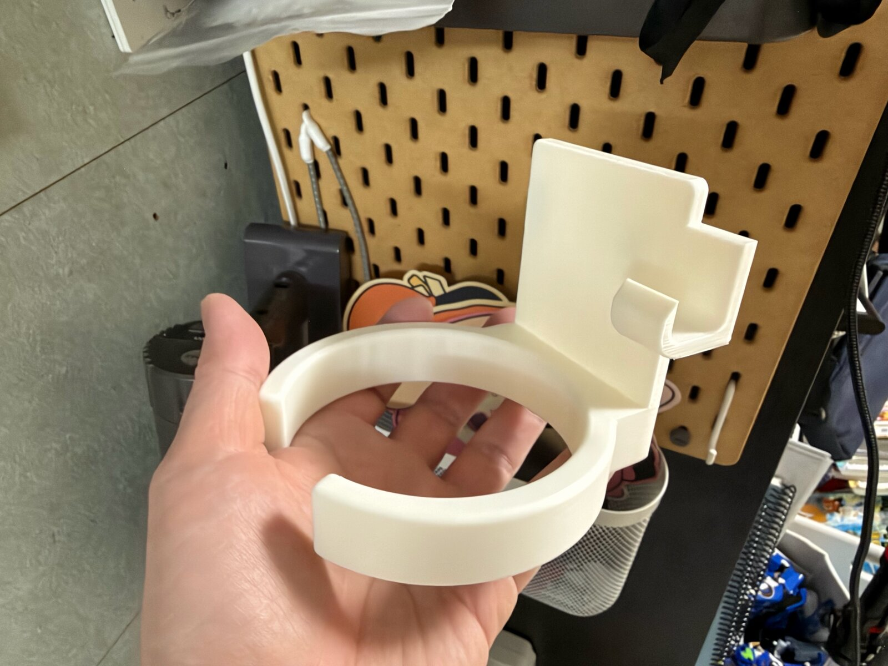
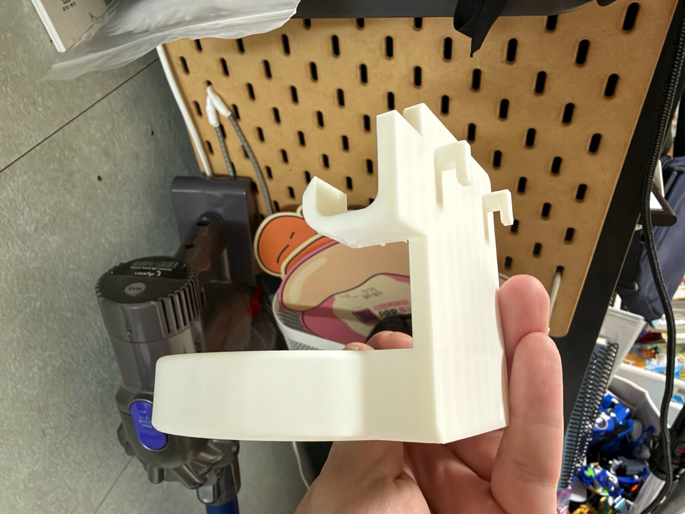
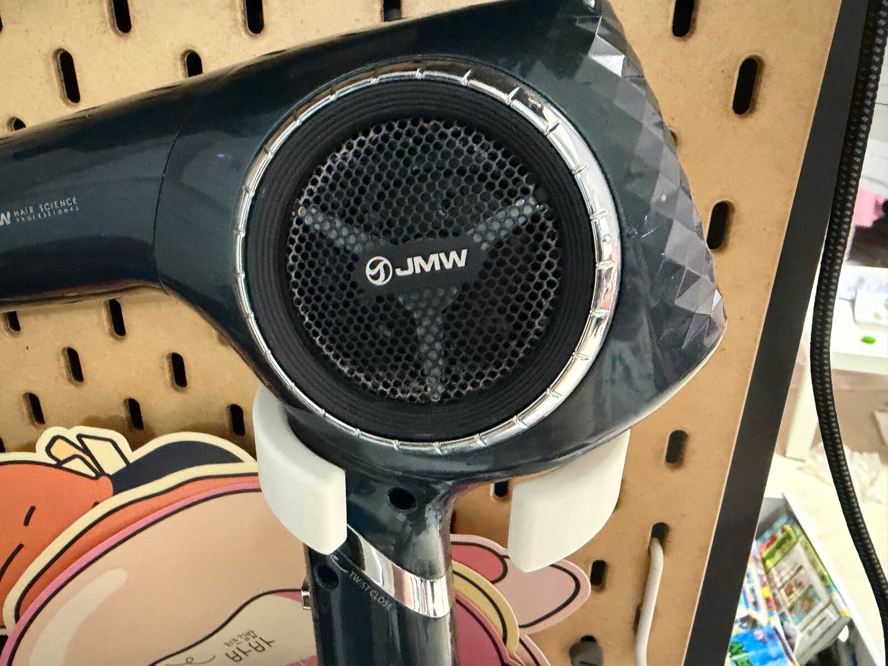
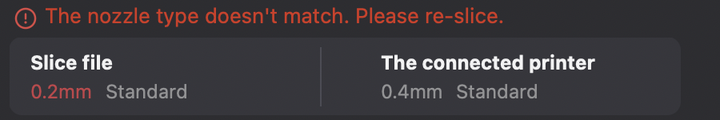
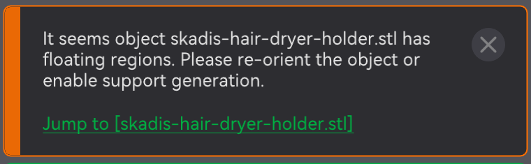

IKEA SKÅDIS 타공판에 거는 헤어드라이어 거치대를 만들었습니다. Claude Code(모델 Fable 5.2, effort high)에 치수를 적은 프롬프트 하나를 넣었고 OpenSCAD 코드와 STL이 한 번에 나왔습니다. 그대로 출력해서 판에 걸었고 잘 걸립니다. 프롬프트는 Gemini에 부탁해서 만들었습니다.

{: w="1600" h="1200" }
_완성본. Bambu Lab A1, PLA로 출력했다_

다만 "한 번에"가 전부는 아니었습니다. 코드와 STL은 한 번에 됐지만, 내보내기 스크립트에 버그가 하나 있었고 슬라이서에서는 제가 두 번 막혔습니다. 그 이야기는 [잘 안 될 때](#troubleshooting)에 모았습니다.

모델 파일은 [MakerWorld](https://makerworld.com/ko/models/3682340-ikea-skadis-hair-dryer-holder-with-cord-hook)에, 소스는 [GitHub](https://github.com/junho85/3d-print)에 올려 두었습니다.

## 요약 {#tldr}

1. **치수를 숫자로 적은 프롬프트**를 주면 OpenSCAD 코드와 STL까지 한 번에 나온다. 이번에는 168줄짜리 코드가 나왔다
2. **결과물은 눈으로만 보지 않는다.** STL을 직접 읽어서 한 덩어리인지, 면이 다 닫혔는지, 치수가 맞는지 숫자로 확인했다
3. **출력 방향은 프롬프트와 다르게 했다.** 프롬프트에는 옆면이나 뒷면을 바닥에 두라고 되어 있는데, 오버행 면적을 측정해 보니 세워서 뽑는 쪽이 훨씬 작았다
4. **서포트는 필요하다.** 뒷면 걸이와 코드 걸이가 공중에서 시작한다. tree 서포트를 켜고 "On build plate only"는 끈다
5. 프롬프트에 빠진 치수는 Claude Code가 채워 넣는다. **어떤 값으로 채웠는지 적어 두면** 나중에 고치기 쉽다

## 준비물 {#parts}

| 준비물 | 내용 |
| --- | --- |
| 프롬프트 작성 | Gemini hydrogen |
| 모델링 | Claude Code, 모델 Fable 5.2, effort high |
| CAD | OpenSCAD 2026.02.01. 화면은 열지 않고 명령줄로만 썼다 |
| 슬라이서 | Bambu Studio |
| 프린터 | Bambu Lab A1, 0.4mm 노즐 |
| 필라멘트 | PLA Basic 흰색 |
| 타공판 | IKEA SKÅDIS |

OpenSCAD는 모양을 코드로 적는 CAD입니다. 마우스로 그리는 과정이 없어서 AI에게 맡기기 좋습니다. 결과가 텍스트 파일이라 치수를 바꾸고 싶으면 숫자만 고치면 됩니다.

## 1단계. 프롬프트 {#prompt}

프롬프트는 Gemini hydrogen에 이렇게 요청해서 받았습니다.

> 이케아 타공보드에 끼울 헤어드라이기 행거를 3d프린팅 할 수 있는 모델로 만들기 위한 프롬프트를 만들어 주세요.

Claude Code에는 먼저 "3D 프린터로 출력하기 위한 모델링 프로젝트 디렉터리 만들어 주세요"라고 요청했고, 그 작업이 도는 중에 Gemini가 만들어 준 아래 프롬프트를 붙여 넣었습니다. 모델링 요청은 이것 하나입니다.

```text
Create a parametric, 3D-printable CAD model of a hair dryer holder compatible with the IKEA SKÅDIS pegboard. Use the following exact dimensions and features:

Backplate: A rectangular plate, 60mm wide, 80mm tall, and 5mm thick, with 3mm filleted corners.

SKÅDIS Hooks: On the rear face of the backplate, create two L-shaped mounting hooks spaced 40mm apart horizontally (center-to-center). Each hook has a 4.8mm width, 4.8mm depth (matching the 5mm board thickness), and a 10mm downward locking tab.

Dryer Ring: Extending horizontally from the lower front of the backplate, create a C-shaped open ring with an 80mm inner diameter, 8mm wall thickness, and 20mm height. Leave a 35mm front opening gap so the hair dryer nozzle or cord can pass through easily. Apply a 2mm fillet to all inner and outer edges to prevent scratching the hair dryer.

Cord Hook: Add a small J-shaped hook (15mm wide, 20mm deep) on the right side of the backplate for hanging the power cord.
Ensure the model is a single manifold solid body, oriented flat on its side or back for easy FDM 3D printing with minimal overhangs.
```

부품을 네 개로 나누고(뒤판, 걸이, 링, 코드 걸이) 부품마다 치수를 숫자로 적은 프롬프트입니다. "적당한 크기로"가 아니라 "안지름 80mm, 벽 8mm"처럼 적혀 있다는 점이 중요했다고 봅니다.

## 2단계. 나온 것 {#result}

Claude Code는 프로젝트 디렉터리를 이렇게 만들었습니다.

```
3d-print/
├── models/
│   └── skadis-hair-dryer-holder/
│       ├── skadis-hair-dryer-holder.scad   소스 168줄
│       └── out/                            STL, 3MF, 미리보기 PNG
└── scripts/
    └── export.sh                           내보내기 스크립트
```

`scad` 파일 맨 위에는 프롬프트의 치수가 변수로 모여 있습니다.

```openscad
/* [드라이어 링] */
ring_id = 80;          // 안지름
ring_wall = 8;         // 벽 두께
ring_h = 20;           // 높이
ring_gap = 35;         // 앞쪽 트임 (가장 좁은 곳 기준)
ring_fillet = 2;       // 모서리 둥글기

/* [SKÅDIS 걸이] */
hook_spacing = 40;     // 두 걸이의 중심 간격
hook_w = 4.8;          // 걸이 너비 (타공 슬롯 너비 5mm에 들어가는 치수)
hook_depth = 4.8;      // 뒤판 뒷면과 걸림턱 사이 틈 (타공판이 끼는 자리)
hook_tab_len = 10;     // 걸림턱 길이 (걸이 윗면에서 아래로)
```

내보내기는 스크립트 한 줄입니다. OpenSCAD 화면을 띄우지 않고 STL과 미리보기 그림을 만듭니다.

```bash
scripts/export.sh skadis-hair-dryer-holder
```

{: w="1200" h="900" }
_내보내기 스크립트가 STL과 같이 만든 미리보기 그림_

### 프롬프트에 빠져 있던 치수 {#decisions}

치수가 자세한 프롬프트인데도 빠진 것이 꽤 있었습니다. Claude Code는 빈 곳을 채운 뒤 어떤 값으로 채웠는지 따로 알려 줬습니다.

| 항목 | 채운 값 | 이유 |
| --- | --- | --- |
| 걸림턱 두께 | 3mm | 프롬프트에 없음 |
| 걸림턱 10mm의 기준 | 걸이 윗면에서 아래로 측정한 전체 길이 | 타공 슬롯 높이가 15mm라서, 목 아래로 10mm를 더 내리면 넣을 여유가 0.2mm밖에 안 남는다 |
| 링 트임 35mm의 기준 | 끝 둥글기를 포함해 가장 좁은 곳 | 끝을 둥글게 하면 어디서 측정하느냐에 따라 값이 달라진다 |
| 코드 걸이 위치 | 뒤판 오른쪽 옆면 바깥 | 앞면에 붙이면 드라이어 몸통과 부딪힌다 |
| 뒤판과 링 사이 | 뒤판 너비만큼 꽉 채운 이음부 | 둥근 링과 평평한 뒤판은 선 하나로만 닿아서 그대로는 붙지 않는다 |

이 표를 받아 두니 나중에 "걸림턱이 짧은데?" 싶을 때 어느 변수를 고치면 되는지 바로 보입니다.

## 3단계. 숫자로 확인하기 {#verify}

렌더링 그림이 그럴듯하다고 출력이 되는 것은 아닙니다. 면이 한 군데라도 열려 있으면 슬라이서가 엉뚱하게 자릅니다. Claude Code는 OpenSCAD의 결과 메시지와 별개로, STL 파일을 직접 읽는 짧은 Python 스크립트로 한 번 더 검사했습니다.

| 검사 | 결과 |
| --- | --- |
| OpenSCAD 상태 | `Status: NoError`, `Genus: 0` |
| 삼각형 | 12,402개 |
| 두 삼각형이 공유하지 않는 모서리 | 0개 (면이 전부 닫혔다) |
| 덩어리 수 | 1개 |
| 전체 크기 | 96.0 x 103.5 x 80.0mm |
| 부피 | 69.2cm³ |
| 링 안쪽 반지름 | 40.0mm |
| 링 트임 | 35.04mm |
| 걸이 중심 간격 | 40.0mm |

프롬프트의 "single manifold solid body"는 덩어리 1개, 열린 모서리 0개로 확인된 셈입니다. Bambu Studio에 올렸을 때도 크기가 95.9946 x 103.524 x 80mm, 부피가 69214.4mm³로 같게 나왔습니다.

{: w="1600" h="881" }
_Bambu Studio에 STL을 올린 화면. 오른쪽 아래 숫자가 스크립트로 확인한 값과 같다_

## 4단계. 출력 방향은 프롬프트와 다르게 {#orientation}

프롬프트 마지막 줄은 "옆면이나 뒷면을 바닥에 두라"는 조건입니다. 그런데 결과물은 **사용할 때 자세 그대로 세운 방향**이었습니다. Claude Code가 이유를 숫자로 가져왔습니다. 세 방향 각각에 대해 45도보다 누운 아랫면의 넓이를 STL에서 계산한 값입니다.

| 방향 | 오버행 면적 | 비고 |
| --- | --- | --- |
| 세운 자세 | 1,152mm² | 이 중 729mm²는 베드에서 2mm 안쪽의 바닥 둥글기 |
| 왼쪽 옆면이 아래 | 3,505mm² | 링이 아치처럼 선다 |
| 뒷면이 아래 | 5,924mm² | 걸이 때문에 뒤판 전체가 베드에서 뜬다 |

프롬프트의 조건(옆면 또는 뒷면)과 목적(오버행 최소)이 서로 맞지 않았던 것입니다. 뒷면에 걸이가 튀어나와 있으니 뒷면을 바닥에 둘 수가 없습니다. 시킨 대로만 했다면 서포트가 다섯 배 들어가는 방향으로 나왔을 겁니다. 다른 방향이 필요하면 변수 하나로 바꿀 수 있게도 해 두었습니다.

```bash
scripts/export.sh skadis-hair-dryer-holder -D 'print_orientation="back"'
```

## 5단계. 슬라이스와 출력 {#print}

Bambu Studio 설정은 다음과 같습니다.

| 항목 | 값 |
| --- | --- |
| 프린터 | Bambu Lab A1, 0.4mm 노즐 |
| 프로세스 | 0.20mm Standard @BBL A1 |
| 필라멘트 | Bambu PLA Basic |
| 벽, 채움 | 벽 2겹, 채움 15% (기본값) |
| 서포트 | 켬, tree(auto) |
| On build plate only | 끔 |

"On build plate only"를 끄는 이유가 있습니다. 코드 걸이 앞쪽 끝의 일부(약 21mm²)가 링 벽 바로 위에 있어서 베드에서 올라오는 서포트만 허용하면 그 부분이 빠집니다.

{: w="1600" h="1200" }
_서포트를 떼어 낸 출력물. 링 모서리의 2mm 둥글기가 그대로 나왔다_

{: w="1600" h="1200" }
_뒷면의 SKÅDIS 걸이 두 개. 서포트가 붙었던 자리다_

## 6단계. 걸어 보기 {#hang}

타공판에 잘 걸립니다. 걸이를 슬롯에 넣고 아래로 내리면 걸림턱이 판 뒤에 걸립니다.

{: w="1600" h="1200" }
_드라이어를 건 모습. 손잡이가 링을 지나 아래로 내려온다_

재미있는 점이 하나 있습니다. 프롬프트에는 앞쪽 트임이 "노즐이나 코드가 지나가도록"이라고 되어 있는데, 실제로는 손잡이를 링에 넣어 거는 쪽이 편했습니다. 몸통이 링 위에 얹히고 손잡이가 아래로 내려옵니다. 모양은 그대로인데 쓰임새가 생각과 달랐습니다.

## 7단계. MakerWorld와 GitHub에 올리기 {#share}

올리는 것도 Claude Code에 맡겼습니다. Chrome을 직접 조작해서 MakerWorld 등록 화면에 파일, 제목, 태그, 설명, 사진을 채웠습니다. 제가 한 일은 로그인과 라이선스 고르기, 그리고 사진 찍기였습니다.

- **MakerWorld**: Bambu Studio 프로젝트(3MF), STL, OpenSCAD 소스를 같이 올렸습니다. 라이선스는 CC BY-NC입니다. 소스까지 공개하면서 "치수를 바꿔 쓰라"고 안내하는 모델이라, 수정본 공유는 허용하고 상업적 이용만 막았습니다
- **GitHub**: 코드와 내보내기 스크립트, 출력물 사진을 [junho85/3d-print](https://github.com/junho85/3d-print)에 올렸습니다

사진을 올리기 전에 Claude Code가 **아이폰 사진에 들어 있는 위치 정보(GPS)를 지웠습니다.** 집에서 찍은 사진이라 그대로 올렸으면 집 좌표가 같이 공개될 뻔했습니다. 직접 올릴 때도 한 번 확인해 볼 만합니다.

```bash
exiftool -GPSLatitude -GPSLongitude 사진.jpg      # 들어 있는지 확인
exiftool -all= -tagsfromfile @ -Orientation 사진.jpg   # 방향만 남기고 지운다
```

## 잘 안 될 때 {#troubleshooting}

### 3MF 파일이 STL과 크기가 똑같다 {#export-format}

내보내기 스크립트의 첫 버전에서 생긴 문제입니다. OpenSCAD에 `--export-format binstl -o a.stl -o a.3mf`처럼 두 형식을 한 번에 내보내게 했더니, 오류 없이 끝났는데 3MF 파일의 내용이 STL이었습니다. `--export-format`은 그 실행의 모든 `-o`에 적용됩니다. STL과 3MF를 따로 실행하도록 고쳤습니다. 두 파일의 크기가 바이트까지 같아서 알아챘습니다.

### The nozzle type doesn't match {#nozzle}

{: w="900" h="150" }
_슬라이스한 설정의 노즐과 프린터에 달린 노즐이 다르다는 뜻이다_

Bambu Studio에 0.2mm 노즐 프리셋이 선택되어 있었는데 프린터에는 0.4mm 노즐이 달려 있었습니다. Prepare 탭에서 **Sync info**를 누르면 프린터의 노즐과 필라멘트 정보를 가져옵니다. 그 뒤 다시 슬라이스합니다.

### floating regions 경고 {#floating}

{: w="760" h="235" }
_서포트 없이 슬라이스하면 나온다_

모델이 잘못된 것이 아닙니다. 뒷면 걸이의 걸림턱과 코드 걸이가 공중에서 시작해서 나오는 경고입니다. 모델을 돌리지 말고 Support 탭에서 서포트를 켭니다.

### Bambu Studio를 닫았더니 모델이 없다 {#untitled}

STL을 불러오기만 하고 저장하지 않으면 프로젝트가 `Untitled` 상태라서 닫을 때 사라집니다. `Cmd+S`로 프로젝트(3MF)를 저장해 두면 프린터와 서포트 설정까지 같이 남습니다.

### 걸이가 판에 안 들어가면 {#hook-fit}

SKÅDIS 판 두께가 공칭 5mm인데 걸이 틈은 4.8mm라서, Claude Code는 출력 전에 "안 걸릴 수 있다"고 경고했습니다. 실제로는 잘 걸렸습니다. 판이나 프린터에 따라 빡빡하면 틈만 넓혀서 다시 내보내면 됩니다.

```bash
scripts/export.sh skadis-hair-dryer-holder -D hook_depth=5.2
```

### PETG 대신 PLA로 뽑아도 되나 {#pla}

됩니다. 저도 PLA로 뽑았습니다. 걸리는 힘은 드라이어 무게 정도입니다. 다만 PLA는 55도에서 60도 사이에서 물러지기 시작하니, 방금 쓴 드라이어는 냉풍으로 몇 초 식힌 뒤 거는 편이 안전합니다.

### 드라이어 몸통이 코드 걸이에 닿는다 {#clearance}

코드 걸이는 링 중심축에서 가장 가까운 곳이 41mm입니다. 링 안쪽 벽(반지름 40mm)보다 1mm 바깥입니다. 몸통이 링 위에서 지름 82mm보다 넓어지는 드라이어라면 `cord_hook_w`를 줄이거나 `cord_hook_z`로 걸이 높이를 바꿉니다.

## 참고 자료 {#references}

- [IKEA SKÅDIS Hair Dryer Holder with Cord Hook (MakerWorld)](https://makerworld.com/ko/models/3682340-ikea-skadis-hair-dryer-holder-with-cord-hook) - 출력 프로필과 STL
- [junho85/3d-print (GitHub)](https://github.com/junho85/3d-print) - OpenSCAD 소스와 내보내기 스크립트
- [OpenSCAD](https://openscad.org/)
- [OpenSCAD 명령줄 사용법](https://en.wikibooks.org/wiki/OpenSCAD_User_Manual/Using_OpenSCAD_in_a_command_line_environment)
- [MakerWorld Print Profile Upload Guidelines](https://wiki.bambulab.com/en/makerworld/tutorials/print-profile-upload)
